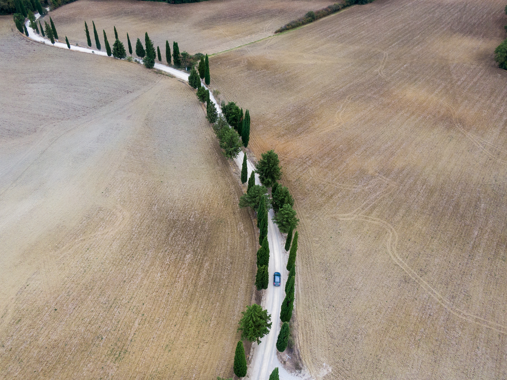

Credits: <a href="https://stocksnap.io/photo/rural-road-XKRV8C936U">Photo</a> by <a href="https://stocksnap.io/author/mattbangophotos">Matt Bango</a> on <a href="https://stocksnap.io">StockSnap</a>

# FOGG

I discovered (quite late I suppose) that Google Maps provides monthly free calls under its 
pay-as-you-go scheme. So all along I had the tools to build an agentic travel agent. Quite sure that
is not a novel idea. Agentic (insert idea here). Really? Hasnt someone else already done that? Sure
but its not mine you see. I want my own.

Specifically, I want something that is personalized, empathetic, pathologically meticulous and yet 
quick witted. In my own travel experiences, I never have the time to plan in depth leading up to my
trip. I often then find myself cutting corners and convincing myself to accept something less than 
ideal because that was all I could find in that time. So I never get to the best set of options my
budget can buy. Worse, when things go wrong, as they inevitably do, I have no backup plan and the
less than optimal travel plan becomes worse. 

Sure its all an adventure and I still enjoy the process of meeting problems, solving them and 
enjoying the moment. **But** I could do with less worrying and more carefree enjoyment. With total 
faith in the plan, one can still enjoy the surprises of serendipitous discovery without constantly
thinking two steps ahead.

I guess thats where this agent comes in. Its your butler and travel agent. Im not that ambitious -
for starters its not going to be this amazing thing on your phone that helps you rebook your 
itinerary everytime theres an issue. For starters its going to be a smart suggestion machine. And 
your decisions to follow or not will give it clues about your preferences.

Note: I dont know why I chose that photo. It just evoked a sense of freedom in me to see a single
road set against a wide clear landscape. 