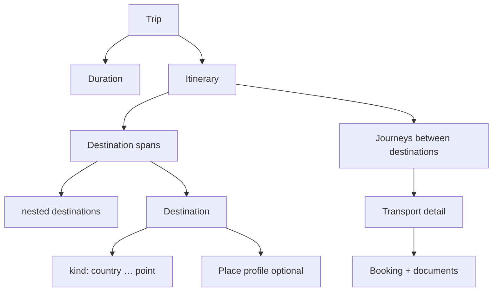

# FOGG — domain model (macro)

Conceptual vocabulary for trips, geography, time, movement, and change over time. UI ([dialogue-interface.md](dialogue-interface.md)) and [user journeys](user-journeys.md) sit on top of this layer.

**Terminology:** use **destination** for every place on the plan (country → **point**). **Point** is the **smallest destination kind**—a location in space, not a separate entity. Use **place profile** for optional subtype + detail on a destination. Do not alternate with “geo unit” or “POI” in the domain docs.

**Principle:** an **itinerary** is only **time** + **destinations**. Everything else—transport, bookings, reviews—hangs off those two axes or off **journeys** between destinations.

---

## Macro picture

```text
Trip
 └── duration (trip window)
 └── itinerary (versioned timeline of time + destinations)
       ├── destination spans   (e.g. Australia, 1 Dec – 5 Dec)
       │     └── nested destinations (e.g. Sydney, Great Barrier Reef)
       └── journeys              (A → B: mode, times, operator, booking)
 └── bookings / documents       (evidence; external payment)
 └── threads / workspace        (dialogue & UI — not domain core)
```



---

## Trip

The **base unit of a vacation plan** (one coherent travel intent).

| Aspect | Description |
|--------|-------------|
| **Purpose** | Container for one plan Alex cares about as a unit: “Japan cherry season 2026”, “Australia Dec 1–5”. |
| **Duration** | Trip-level **window**: earliest start → latest end (may refine as itinerary detail grows). |
| **Itinerary** | The spatiotemporal plan inside the trip (see below). |
| **Status** | e.g. draft → planned → booked → in progress → completed (lifecycle, not versioning). |
| **Other** | Budget envelope, travelers, canonical dialogue thread, etc.—orthogonal to itinerary shape. |

A trip always has exactly one **active itinerary head** (current committed version pointer). History lives in **itinerary versions**.

---

## Itinerary

At its core, an itinerary is **only**:

1. **Time** — dates, ranges, local day boundaries, optional clock times as detail accrues.
2. **Destinations** — placed on that timeline (possibly nested).

No transport, hotels, or bookings are required for something to count as an itinerary. Those attach via **place profile**, **journeys**, and **bookings** when known.

### Coarse → fine planning

| Stage | Example (spoken) | Itinerary shape |
|-------|------------------|-----------------|
| **Broad** | “Australia, 1 Dec – 5 Dec” | One **destination** (country: Australia) spanning **1/12–5/12**. |
| **Refined** | “Sydney then Cairns” | Country span **contains** city destinations; dates subdivide. |
| **Detailed** | “Lunch at X, hotel Y” | **Venue** destinations (named) or **point** destinations (lat/lng only) with times under a city span. |

The agent and user **subdivide** destinations over time; the tree deepens without changing the definition of itinerary.

### Destination spans

A **destination span** binds:

- a **destination** (see below), and
- a **time range** (inclusive start/end date at minimum; optional time-of-day).

Sibling spans under the same parent should not overlap in time unless explicitly modeled (e.g. “layover overlap” is a journey, not two full destination spans).

---

## Destination

Every location on the itinerary is a **destination**. Same term at every scale; the **kind** (large → small) tells you what it represents.

| Kind (large → small) | Examples |
|----------------------|----------|
| **country** | Australia, Japan |
| **region** | Queensland, Kanto (state / prefecture / province) |
| **city** | Sydney, Kyoto (locality) |
| **district** | Gion, CBD (neighborhood) |
| **venue** | Named hotel, museum, restaurant |
| **point** | A **location in space only**—latitude/longitude (optional elevation). No name required. “Meet here”, map pin, drop-off. |

**Point** destinations are still destinations: they sit on the itinerary tree and in **destination spans** like any other kind. They often have **no place profile**—only coordinates—or gain a profile later when refined into a **venue**.

**Rules of thumb:**

- Larger destinations **contain** smaller ones (Australia → Sydney → venue or point).
- **Country / region / city** may use **bounds** rather than a single coordinate.
- **Venue** vs **point:** venue = named place; point = pure geometry on the plan. A venue’s profile usually includes coordinates; a point destination *is* that geometry.
- One real-world place may appear as multiple destination records; link by id.

### Place profile

Optional enrichment on a **destination** (most often **venue**; sometimes **point** upgraded to venue). **Kind** = where it sits in the hierarchy; **profile subtype** = what you do there.

| Profile subtype | Role |
|-----------------|------|
| **accommodation** | Stay, check-in/out |
| **food** | Eat/drink |
| **attraction** | See/do |
| **utility** | ATM, laundry, generic service |
| **security** | Police, safe point |
| **embassy** | Consulate, embassy |
| **medical** | Clinic, hospital, pharmacy |
| **transport** | Station, airport, stop (as a *location*, distinct from a **journey** leg) |

**Detail** (when known): coordinates (required for **point** kind), bounds (for large kinds), address, contact, **pricing**, **reviews**, **operating hours**, notes.

Detail may be partial in draft planning; committed versions may still leave fields empty with explicit “unknown”.

---

## Journey

A **journey** is **travel from one destination to another** (same scale or different—e.g. city to city, airport to hotel).

| Field | Description |
|-------|-------------|
| **From / to** | **Destination** references (any kind, including **point**). |
| **Departure / arrival** | Target or actual times (refined over planning). |
| **Transport** | See below. |

Journeys sit **between** destination spans or **link** nested destinations (“Sydney → Cairns flight on 3 Dec”). A **stay** is a destination span; a **move** is a journey.

---

## Transport

Details of how a **journey** is executed:

| Aspect | Description |
|--------|-------------|
| **Mode** | e.g. flight, train, ferry, car, walk, rideshare. |
| **Operator** | Airline, rail company, rental agency, etc. |
| **Booking** | Optional record: PNR, reference, status (held, paid externally, cancelled). |
| **Booking documents** | Tickets, passes—stored in **document** store, linked to booking. |

FOGG does **not** process payment ([non-goals](user-journeys.md#non-goals-explicit)); transport **bookings** are tracked, not charged in-app.

---

## Change over time: versions, drafts, forks

Three layers—do not conflate them.

### 1. Committed itinerary versions (`v1`, `v2`, …)

- **Immutable** once saved (append-only history).
- Created when user **commits** (“save”, “apply plan”, agent-confirmed checkpoint).
- **Revisit:** open read-only or **fork** from any version.
- **Compare:** diff any two versions ([`diagram` / `itinerary_diff`](frame-journey-map.md)).

### 2. Draft edits (working copy)

- Mutable buffer **on top of** a base version (usually current head).
- All planning UI and dialogue mutations hit **draft** first.
- **No undo stack** in product terms: user reverses by editing draft or **discarding draft** back to base version.
- **Not** visible as a version until **commit** → new `vN`.

```text
        v3 (committed, frozen)
          │
          ▼
      [ draft ]  ← edits, forks from v3, agent proposals
          │
     commit │
          ▼
        v4 (committed)
```

### 3. Forks (options / what-if)

- **Fork** = new draft lineage from a **specific committed version** (or from another fork), often tied to a [dialogue thread fork](dialogue-interface.md).
- Used for options: “what if we leave Dec 2 instead?”
- Each fork has its own draft; **committing** a fork produces a new version and may update trip **head** (user chooses canonical line).

| Action | Result |
|--------|--------|
| Edit in place | Draft changes; commit → new version |
| Discard draft | Draft dropped; head unchanged |
| Fork from v2 | New draft branch from v2; independent commit → v5, v6, … |
| Merge fork (product decision) | Commit winning fork as next version; other forks remain in history |

**Spoken itinerary** in chat narrates the **draft**; commit makes it **versioned truth**.

---

## Bookings & documents (adjacent, not itinerary core)

| Concept | Role |
|---------|------|
| **Booking** | Links transport (or packaged leg) to external confirmation. |
| **Document** | PDF/image/email artifact; linked to booking or trip. |
| **Segment** (operational) | Shorthand for a journey leg or a destination span—for booking and “today” views. |

Stale bookings: if a **new version** removes a journey or destination span, bookings **flag** stale; do not auto-delete.

---

## Dialogue & UI (complementary)

- **Trip board / drawer:** list trips—not part of itinerary math.
- **Frames:** projections of draft or version (map, timeline, bookings board).
- **Thread:** audit of *why* versions changed; not source of truth for time/destinations (itinerary store is).

---

## Glossary (quick)

| Term | One line |
|------|----------|
| **Trip** | Vacation plan container: duration + versioned itinerary. |
| **Itinerary** | Time + destination spans only. |
| **Destination** | Every planned place; **kind** from country down to **point**. |
| **Destination kind: point** | Smallest destination—location in space (lat/lng), name optional. |
| **Destination span** | Destination + date/time range on the itinerary. |
| **Place profile** | Optional profile subtype + detail on a destination (common on venue). |
| **Journey** | Move from destination to destination with departure/arrival. |
| **Transport** | Mode, operator, booking, docs for a journey. |
| **Version** | Committed snapshot `vN`. |
| **Draft** | Uncommitted edits; no undo—discard or commit. |
| **Fork** | Branch draft from an old version / thread for options. |

---

## Related docs

- [User journeys](user-journeys.md) — flows using this model
- [Itinerary versioning (journey doc)](user-journeys.md#itinerary-versioning) — align with draft/commit rules above
- [Google Maps alignment](google-maps-alignment.md) — FOGG ↔ Place, Waypoint, Route/Leg, Geocoding
- [Dialogue interface](dialogue-interface.md) — how drafts/versions appear in chat and frames
- [Frame ↔ journey map](frame-journey-map.md) — UI coverage

When backend schemas land, add a short pointer in [`AGENTS.md`](../AGENTS.md) to this file.
