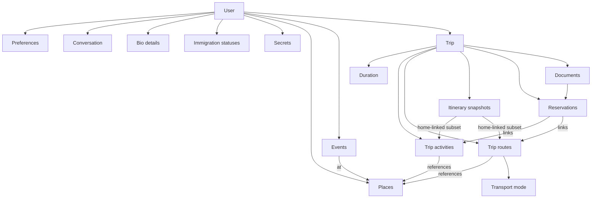

# FOGG — domain model (macro)

Conceptual vocabulary for trips, geography, time, movement, and change over time. UI ([dialogue-interface.md](../dialogue-interface.md)) and [user journeys](../user-journeys.md) sit on top of this layer.

**Terminology:** **Place** and **Event** are things we **know**—they exist with or without a **Trip**. **Activities** and **routes** on a trip **reference** places; they do not own them. Use **activity** for a **planned stop or experience** on a **Trip** only when **place** and **start time** are known (see [Activity](#activity)); vague intent stays in **conversation messages** until then (see [Conversation](#conversation)). **Place classification** aligns with [Google’s domain model](../google-maps-alignment.md). **FOGG place** / **FOGG route** / **Trip** / **daytrip** / **Event** as below. Do not alternate with “geo unit” or “POI” in the domain docs.

**Principle:** **Places** (permanent) and **events** (time-bounded) form the user’s **known world**. **Trips** add **activities** and **routes** that point at those places. **Preferences** are user/trip-scoped (not place-targeted rows). An **itinerary** exists only when trip **activities** and **routes** link **home → … → home** ([bio details](#bio-details) **home address**). **Events** are uncovered through **research** and may inform trips—they are not **activities**.

---

## Macro picture

```text
User
 ├── bio details          (gender, home address, …)
 ├── immigration statuses (citizenship, PR, visa — per country)
 ├── preferences          (structured taste; evidenced by messages)
 ├── preference summary   (live summary of known tastes and constraints)
 ├── trip summary         (live summary of the user's trips)
 ├── conversation         (threads + messages — chronological record)
 ├── secrets              (credentials the user supplies for connected services)
 ├── reminders & monitors (same store — surfaced in conversation at alert_at)
 ├── places               (persistent—known whether or not on a trip)
 ├── events               (time-bounded—known whether or not on a trip)
 └── Trip(s)
       ├── duration (trip window, optional until known)
       ├── activities            (place + starts_at; created when both known — not vague intent)
       ├── routes                  (reference places; moves—including daytrips)
       ├── itinerary snapshots     (materialized home→…→home paths; see below)
       ├── reservations        (held slots; payment + operator; tie to plan entities)
       ├── documents             (tickets, PDFs — evidence)
       ├── reminders             (optional trip/thread scope)
       └── threads / workspace   (dialogue & UI — not domain core)
```



---

## User

The **person who plans and travels** (account holder). Trips belong to a **user**; dialogue, auth, and billing identity hang off the same entity.

| Field / collection | Role |
|--------------------|------|
| **Bio details** | Master container for factual **about-the-person** fields (see below)—distinct from taste (**preferences**) and **conversation**. |
| **Immigration statuses** | List of **citizenship**, **permanent resident**, and **visa** records per country (see below)—not a single citizenship field. |
| **Preferences** | Structured taste and constraints used by the agent to **rank and recommend** (see below); provenance via **message** links. |
| **Preference summary** | Live summary of the user's known preferences. Starts empty. |
| **Trip summary** | Live summary of the user's trips. Starts empty. |
| **Conversation** | **Threads** and **messages** (LangGraph-shaped log)—see [Conversation](#conversation). |
| **Secrets** | User-provided **credentials** for external services the agent may call (see below)—never mixed with **messages** or **preferences**. |
| **Reminders & monitors** | **`reminders`** rows; harness surfaces at **`alert_at`** (see [Reminders and monitors](#reminders-and-monitors)). |
| **Places** | Persistent locations we **know**—not owned by a trip (see [Place](#place)). |
| **Events** | Time-bounded happenings we **know**—not owned by a trip (see [Event](#event)). |

### Bio details

**Bio details** group stable profile facts the user (or onboarding) supplies. They are **not** used like **preferences** for ranking unless a product rule explicitly says so.

| Field | Role |
|-------|------|
| **Name** | Name the user provides at onboarding. |
| **Gender** | Optional. Store only what the user provides; do not infer. |
| **Home address** | Usual **origin** for planning (commute to airport, “from home” routes, local timezone). Geocode → **`home_geom`** (+ formatted address / viewport)—see [google-maps-alignment.md](../google-maps-alignment.md). |
| **Home country** | Country associated with the user's home address. Citizenship, residency, and visas are recorded separately. |

Add new bio fields here over time (e.g. date of birth if needed for fares)—keep **one** container rather than top-level user columns. **Citizenship and visas** live under **[immigration statuses](#immigration-status)**, not here.

### Immigration status

An **immigration status** is one row in the user’s list: a legal relationship to a **country**. People may have **many** rows (multiple citizenships, PR in one country, visa for another).

| `kind` | Meaning (examples) |
|--------|---------------------|
| **citizenship** | Citizen **of** that country |
| **permanent_resident** | Permanent resident **in** that country |
| **visa** | Travel or entry **visa** for that country |

| Field | Role |
|-------|------|
| **Country** | Which country the status applies to (ISO country code). |
| **Kind** | `citizenship`, `permanent_resident`, or `visa`. |
| **Valid from / until** | For visas and time-bound permission; often open for citizenship. |
| **Label** | Optional detail (e.g. tourist visa, work visa). |

Used for visa hints, entry planning, and dialogue context—with explicit **not legal advice** in product. Do not store passport or visa document numbers in v1 unless paired with a secrets/PII policy.

### Onboarding and profile context

At account creation, the basic details form collects name, home address, and home country. Gender and immigration statuses are optional. The FOGG account owns these details regardless of which identity provider verifies the sign-in. The master agent receives the user's name, home country, recorded immigration statuses, and both summaries as YAML. The full address remains available for planning routes from home.

```yaml
name: Alex
home_country: SG
immigration_statuses: []
preference_summary: null
trip_summary: null
```

The master agent's system instructions tell it to occasionally ask for missing details during ordinary chat and save the facts the user supplies or corrects. An empty immigration list means no statuses have been recorded. While the preference summary is empty, the agent occasionally asks a travel preference question that fits the conversation, such as whether Alex prefers a cheaper fare or fewer connections.

Both summaries are stored per user and updated over time. Structured preferences and trip records remain the detailed sources. The process for building and refreshing the summaries will be designed separately.

### Preferences vs conversation

| | **Preferences** | **Conversation (messages)** |
|---|-----------------|------------------------------|
| **Purpose** | Drive **recommendations**, option ranking, disruption alternatives | **Chronological** record of what was said (user + agent) |
| **Shape** | Structured or semi-structured (`key`, `value` json) | **Messages** with stable `message_id`, `role`, `content` |
| **Examples** | `walkable`; `food.dish_to_try` + **note** “bistecca in Florence” | “I like bistecca—I want to try it in Florence” (stays in transcript) |
| **Scope** | **User** defaults; optional **Trip** overrides (`trip_id`) | **Threads** (optionally **trip**-scoped); link messages to entities |

The **agent** creates **preferences** from dialogue—users do not say “add a preference.” Each turn, load **active** preferences (`superseded_at` null) via **embedding** similarity and **place** geo (**`tagged_place_refs`**). Store **`preference_evidence`** → `message_id`(s) for replay.

**Supersession (forward only):** a new expression **inserts** a row, sets **`superseded_preference_ids`** to replaced ids, and marks those rows **`superseded_at`**. Similar taste **consolidates** by superseding the prior head; **conflicts** resolve (deduce or ask user) then supersede the contradicted id(s). Superseded rows drop from the embedding index; history only via **`superseded_preference_ids`** chains.

**No fulfillment table:** whether a desire was “met” is **just-in-time**—agent compares active preferences to **past/nearby activities** when recommending—not stored deterministically.

UI signals (accept/dismiss options) may prompt new preference rows with evidence; they do not duplicate full prose outside the thread.

### Secrets

**Secrets** are the master container for **sensitive connection material** the **user** opts in to store so the **agent** can reach third-party services **on their behalf**—for example:

- **LLM** or other model provider API keys (bring-your-own-key)
- **OAuth tokens** or app passwords for mail, calendar, or social accounts the user wants mined for trip context (confirmations, inspiration, contacts)
- Future integrations (loyalty logins, travel apps)—each as a typed **secret slot**, not ad hoc fields on the user row

**Product intent:** the user **supplies** credentials; FOGG **uses** them only for tasks the user asks for (e.g. trawl inbox for tickets, summarize a saved post)—not for ranking taste (**preferences**) and not as a substitute for stored **messages**.

**Platform vs user:** server env keys (e.g. shared `GOOGLE_MAPS_API_KEY` for `gmaps`) are **deployment secrets**, not entries in this container. **Secrets** here means **per-user** vault data.

#### Where secrets live (evolve deliberately)

| Phase | Storage | Notes |
|-------|---------|--------|
| **Now (personal / device-first)** | **User’s device** — OS-backed secure storage (Keychain, Keystore, encrypted web storage pattern). **Encryption at rest** is required. The agent/harness on or beside the device reads the vault; credentials do not need to live on FOGG servers for v1. |
| **Later (hosted product)** | Optional **server-side** vault if users want sync, web-only clients, or managed connectors. Much higher bar: KMS/HSM, strict ACLs, audit, consent per connector, breach response, compliance—design only when the business model requires it. |

**Build awareness:** treat **secret access** as a small interface (get/set/revoke by slot, never return raw values to logs or frames). Trip and chat payloads reference **connection ids**, not key material. Same domain object (**secrets** container); swap **local vault** vs **remote vault** implementation without renaming user-facing concepts.

**Always:** never log secret values; never echo in chat or client-visible errors; rotate/revoke in UI; agent tools use minimum scope per connection.

---

## Trip

The **base unit of a vacation plan** (one coherent travel intent), owned by a **user**.

| Aspect | Description |
|--------|-------------|
| **Purpose** | Container for one plan the user cares about as a unit: “Japan cherry season 2026”, “Australia Dec 1–5”. |
| **Duration** | Trip-level **window**: earliest start → latest end (may refine as itinerary detail grows). |
| **Activities** | Planned things to do on this trip—**not** required to be timed or part of an itinerary yet. |
| **Routes** | Moves between places—may exist before the itinerary is linked. |
| **Itinerary** | Optional until a complete home→…→home path exists (see [Itinerary](#itinerary)); stored as indexed snapshots. |
| **Status** | e.g. draft → planned → booked → in progress → completed (lifecycle, not versioning). |
| **Other** | Budget envelope, additional travelers (future), trip-scoped **preference overrides**, canonical dialogue thread, etc. |

When a complete path exists, the trip points at one **selected snapshot** (`head_itinerary_version_id`). **Activities** (timed stops) can exist on the trip **before** any snapshot is materialized.

---

## Activity

An **activity** is a **planned stop or experience** on a **Trip**—something that would appear as a line on a day list or map pin (e.g. walk in Central Park, night at ABC resort). **Booking is not required**; many activities stay **wishlisted** with no **reservation**.

### Minimum bar (persistence)

Do **not** insert an **activity** row until **both** are known:

| Required | Meaning |
|----------|---------|
| **Place** | Resolved **place** (see [Place](#place)—park, hotel, city POI, …). |
| **Start time** | `starts_at` — when the visit/stay **begins** (date + clock or trip-local convention). |

**End time** (`ends_at`) is optional (open-ended visit allowed). Until place + start time are known, context stays in **messages**—link the **message** to **trip** / **place** when scoped (e.g. “wants to visit a park”—then “where?” / “when?”). Coarse intent (“visit America”) or unnamed categories (“some ski resort”) are **not** activities.

| Field | Required? | Description |
|-------|-----------|-------------|
| **Place** | Yes | Where. |
| **Start time** | Yes | When the stop begins. |
| **End time** | No | When it ends, if known. |
| **Status** | Yes (default **wishlisted**) | Lifecycle on the trip—see below. |
| **Label** | No | Spoken/UI name (“explore Paris”, “dinner at X”). |

### Activity status

| Status | Meaning |
|--------|---------|
| **wishlisted** | On the trip plan; **not** reserved (default for new activities). |
| **reserved** | At least one **reservation** links to this **activity**. |
| **in_progress** | User is currently at / doing this activity (on-trip). |
| **completed** | Finished. |

**Reserved** may be derived when a reservation links; store explicitly if that simplifies UI sync. **Routes** use the same four statuses (see [Route status](#route-status)).

An activity **does not** need to sit inside a committed **itinerary** to exist or carry a status. It may exist on the trip before routes link it into a candidate itinerary.

### Relative priority

If the user cares more about one stop than another (“Paris matters more than Normandy”), link the **message**(s) to **trip** / **place** / **activity** and/or promote a **trip-scoped preference** with **evidence**—not extra fields on the activity row.

Optional **`parent_activity_id`**: lightweight grouping only (e.g. “Day 2” bucket)—**not** geographic hierarchy (country → city). Sibling activities with **times** should not overlap unless explicitly modeled.

**Routes** are not activities: a **stay** or **visit** is an **activity**; a **move** is a **route**.

---

## Itinerary

An **itinerary** is **not** “every activity on the trip.” It is one **complete path**: **home → … → home** through **routes** and **activities** on the trip (home from **bio details**).

You *could* rediscover such paths by graph search on every request; that gets expensive. FOGG **materializes** each found path as an **itinerary snapshot** (`itinerary_versions` + ordered **`itinerary_version_steps`**: `home` | `activity` | `route`). Users see **plan names** or descriptions—not internal version numbers.

| Phase | Example |
|-------|---------|
| **Intent only** | “Visit a park”—**messages**; **no** activity rows. |
| **Stops on trip** | Central Park + date, resort + check-in—**activities**; may still have **no** complete path. |
| **Executable plan** | Outbound/return **routes** + stops form home loop—agent writes a **snapshot**; user **selects** it (`head_itinerary_version_id`). |

**Activities** on the trip but **not** on a snapshot’s step list are still on the pool (e.g. alternate resort with no legs yet).

**Invalidation:** if a **route**, **activity**, or underlying **place** becomes unusable, mark every snapshot that references it **`broken`** (`broken_reason`); clear or move **head** if needed; **reservations** on affected steps → **`stale`**. Do not silently keep executing a broken index.

**Routes** carry transport and **reservations**; **place details** and linked **messages** enrich planning without changing step-list rules.

---

## Place

A **place** is a **persistent** location we **know** about—a city, hotel, pin, country, venue. It **exists whether or not** any **Trip** references it. **Permanence** here means identity over time in the user’s catalog, not that the real-world business never closes.

**Trips** do not contain places; **activities** and **routes** **reference** `fogg_place_id`. A **place** may exist in the catalog before any **trip** references it.

Nesting (region → city → venue) in **plan structure** is expressed through **activities** on a trip, or through relationships between **place** records—not by requiring a trip to exist.

### Classification

Place types align with **Google’s domain model**:

| Source | Use for |
|--------|---------|
| Places API | `primaryType`, `types[]` on the [Place resource](https://developers.google.com/maps/documentation/places/web-service/reference/rest/v1/places) |
| Geocoding | `address_components[].types` (e.g. `locality`, `country`, `administrative_area_level_1`) |
| Map pin only | **`geom`** on the FOGG place; optional reverse Geocode to fill types and label later |

UI and agent copy may **summarize** (“city”, “restaurant”) in natural language; persisted classification follows **Google’s types**.

### Identity & geometry

| Situation | Typical fields |
|-----------|----------------|
| Named POI / area from Places or Geocode | `google_place_id`, `display_name`, **`geom`** (point), **`bounds_geom`** (region polygon from viewport) |
| Pin drop / “meet here” | **`geom`** required; `google_place_id` optional until resolved |
| Same real world, multiple plan rows | Separate **FOGG place** records; share `google_place_id` when same Google entity |

**Spatial queries** (containment, distance, nearest) use **PostGIS** on **`geom`** / **`bounds_geom`** — see [geospatial.md](geospatial.md). An activity at “World Trade Center” is a **point**; a strike “in New York” is a **polygon**; affected activities are found with **`ST_Contains`**, not name matching.

### Place details

Optional fields on a **place**—often hydrated from **`PlacesGetRequest`** (field mask controls cost). Context like “must try” or door codes: **messages** linked to **place** / **activity**, or **preferences** with **evidence** when used for ranking—not ad hoc duplicate prose tables.

Examples: coordinates, address, contact, hours, rating/reviews, `priceLevel` where available. May be partial in draft; committed versions may leave gaps as explicit “unknown”.

See [google-maps-alignment.md](../google-maps-alignment.md) for field-level mapping; [geospatial.md](geospatial.md) for PostGIS.

---

## Event

An **event** is something **happening** in the world at a **place** over a **duration**. Like **places**, events are things we **know**—they are **not tied to a Trip**. Research (agent, web, social, official listings) adds and updates them in the user’s catalog.

Examples: a **festival**, a **transit strike**, a **public holiday** in a city you will visit. Not all events are desirable; some are opportunities, some are disruptions.

### Event vs place

| | **Place** | **Event** |
|---|-----------|-----------|
| **Nature** | Ongoing venue or area (restaurant, city, hotel) | **Infrequent** or **ad hoc** occurrence tied to that place |
| **Cadence** | Regular operation (e.g. daily opening hours) | Roughly **monthly or less**, or **one-off**—not “every Tuesday” business as usual |
| **Planning** | Anchor for **activities** and **routes** | **Context** for research and decisions; may prompt new activities or route changes |

A permanent **place** can host many **events** over time.

### Fields

| Field | Required? | Description |
|-------|-----------|-------------|
| **Place** | Yes | Anchor label (city, venue, …); region **polygon** often on **`places.bounds_geom`**. |
| **Affected area** | No | **`events.affected_geom`** when impact shape is custom or overrides place bounds. |
| **Duration** | Yes | Start/end (dates; optional times). |
| **Title / summary** | No | Human-readable name (“Cherry blossom festival”, “Metro strike”). |
| **Organizer** | No | When official organizers exist: **name** + **contact details** (phone, email, URL). |
| **Tickets** | No | Whether tickets are required; **reservation** / **documents** if the user buys. |
| **Opening hours** | No | Event-specific hours when they differ from the underlying **place** profile. |

Research provenance (source URLs, “seen on social”): **agent message** (+ optional URL in content) with **message_entity_links** to the **event**, not a hard-modeled field in v1.

### Event status

Distinct from **activity** / **route** status (wishlisted, …):

| Status | Meaning |
|--------|---------|
| **suspected** | Weak signal (e.g. social rumor, unverified)—may still affect dialogue cautiously. |
| **known** | Corroborated; **organizer** identified when applicable. |
| **in_progress** | Happening now (relative to trip or “today”). |
| **completed** | Finished. |

Promote **suspected → known** as research confirms; do not treat **suspected** as ground truth for irreversible bookings without user confirmation.

### Relation to trips

An **event** does not belong to a trip. When dates and **places** overlap a **Trip**, the agent may suggest **activities**, **routes**, or cite linked **messages**. **Spatial overlap:** indexed query from event polygon to activity **place** points (see [geospatial.md](geospatial.md)) — e.g. NYC strike affects WTC activity without explicit city in the activity label. Adding “go to the festival” is a new **activity** referencing the event’s **place**—not re-parenting the **event**.

---

## Route

A **route** is **travel from one place to another** on a **Trip** (e.g. city to city, airport to hotel, pin to pin)—like **activities**, it can exist **before** it is timed or included in an **itinerary**.

| Field | Required? | Description |
|-------|-----------|-------------|
| **From / to** | Yes (may be partial on a **daytrip**) | **Place** references (with `google_place_id` and/or **LatLng**). |
| **Departure / arrival** | No | Target or actual times when known. |
| **Transport** | No | Mode and operator hint—see [Transport](#transport). |
| **Status** | Yes (default **wishlisted**) | Same lifecycle as **activities**—see below. |

### Route status

| Status | Meaning |
|--------|---------|
| **wishlisted** | On the trip plan; not necessarily scheduled or reserved (default for new routes). |
| **reserved** | At least one **reservation** links to this **route**. |
| **in_progress** | User is currently on this leg (on-trip). |
| **completed** | Finished. |

A **route** does not need to be in an **itinerary** to exist or carry a status.

**Reservations** can be made on a **route** (flight, transfer), on an **activity**, or **on both** in one booking that spans stay + legs. A **stay** or **visit** is an **activity**; a **move** is a **route**.

When we call Google **`computeRoutes`** for **overland** modes, persist **`google_route_ref`** (trimmed response, encoded polyline) and decode to **`path_geom`** (PostGIS linestring) for map frames and spatial queries—see [google-maps-alignment.md](../google-maps-alignment.md), [geospatial.md](geospatial.md). **Air**, open-ocean, and not-yet-computed routes leave **`path_geom`** null; use **from/to** stopovers for coarse checks.

### Daytrip (route variant)

A **daytrip** is still a **route**, specialized for **operator-packaged movement** when the exact **places** and leg **routes** are not known yet (common for tour desks, drivers, day packages).

| | **Ordinary route** | **Daytrip** |
|---|-------------------|-------------|
| **Endpoints** | From/to **places** (or pins) identified on the plan | Itinerary **intent** described (e.g. “hotel → three wineries → city drop-off”) with **placeholder** or partial places |
| **Legs** | One segment A → B | **Planned** as multiple legs; refine into concrete routes + activities as detail arrives |
| **Typical use** | Flight, transfer you mapped | “Day trip with agent”—may later expand to 5 **places** and 4 **routes** |

---

## Transport

Details of how a **route** is executed:

| Aspect | Description |
|--------|-------------|
| **Mode** | e.g. flight, train, ferry, car, walk, rideshare. |
| **Operator** | Often mirrored on the linked **reservation**; may be duplicated here for quick display. |

Commercial hold and payment sit on **reservations** (below), not on the route row alone.

---

## Conversation

FOGG persists dialogue in a **LangGraph-compatible message list**: each **message** has a stable **`message_id`**, **`role`** (`user`, `assistant`, `system`, `tool`), and **`content`**, ordered in a **thread**. This is the **chronological source of truth** for what was said—not a separate note/journal table.

### Threads

A **conversation thread** belongs to a **user** and optionally a **trip**. Forking (see [dialogue-interface.md](../dialogue-interface.md)) creates a new thread with `parent_thread_id` and `fork_at_message_id`. Mark one thread **canonical** per trip when bookings/documents need a single line of history.

### Message ↔ entity links

Attach planning context **per message** (no character ranges): **`message_entity_links`** `(message_id, entity_kind, entity_id)`.

| Use | Example |
|-----|---------|
| Vague intent | User message → link **trip** |
| Place-scoped chat | “That hotel looks great” → link **place** |
| Activity discussion | After activity exists → link **activity** |
| Event research | Agent summary → link **event** |

When the agent needs context, load the **linked message** and a **surrounding window** (e.g. adjacent messages in the same thread)—not a second prose store.

### Inline place tags (messages & preference notes)

Prose may tag resolved mentions—geometry is **not** embedded in the string:

```text
I want to go to <place id=0>New York</place> in fall
```

| Piece | Role |
|-------|------|
| **Tagged text** | Stored in **`conversation_messages.content`** or **`preferences.note`** as written (including tags). |
| **`tagged_place_refs`** | One row per tag: host (`message_id` **or** `preference_id`), **`tag_index`** (= `N` in `id=N`), **`place_id`** → **`places.geom`** / **`bounds_geom`**. |
| **Agent** | Geocode / Places → upsert **place**, write tags + ref rows (tools)—users do not manage tags manually. |

**`message_entity_links`** stay **message-level** anchors (trip, activity, whole-turn place). **Tags** are **in-text** mentions for display, replay, and **proximity** (itinerary route/activities vs tagged **places**—see [geospatial.md](geospatial.md)). Optional **`proximity_radius_m`** on a ref for POI “near” without a region polygon.

### Preferences (persistence detail)

**Preferences** are structured rows: **`key`**, **`value`** (json), optional **`note`** (may use **place tags**), optional **trip** scope, **`superseded_preference_ids`**, **`superseded_at`**. Place grounding via **`tagged_place_refs`** on **`note`**.

| Link / field | Role |
|--------------|------|
| **`preference_evidence`** | Source **`message_id`**(s) for the expression. |
| **`superseded_preference_ids`** | On the **new** row: ids replaced (similar merge or conflict resolution). |
| **`superseded_at`** | On **old** rows: out of active retrieval; rows retained for audit. |

**Retrieval:** embedding index + geo on **active** rows only; each message turn refreshes the set the agent sees.

**Recommendations:** active preferences + nearest/relevant **activities** (and trip context); agent judges overlap with past experiences at query time—no persisted fulfillment link.

---

## Reminders and monitors

Stored in **`reminders`** only. Product language distinguishes:

| Term | Meaning |
|------|---------|
| **Reminder** | **One-shot** (`kind = once`): fires at **`alert_at`**, then done (delete or leave as history). |
| **Monitor** | **Recurring** (`kind = monitor`): same table; after each fire, harness sets **`alert_at`** += **`interval_seconds`** until **`monitor_until`** or deleted. |

Examples: **reminder** — “check in for flight at T-24h”; **monitor** — “poll this **event** every 6h while **activity** is in progress”; **monitor** — flight status until departure.

| Field | Role |
|-------|------|
| **alert_at** | Next time to inject into **conversation** (user and agent see it). |
| **note** | What to do; entity **`id`**s inline in prose—**no** link table. |
| **trip_id** / **thread_id** | Optional scope for trip or **thread**. |
| **interval_seconds** / **monitor_until** | **Monitor** scheduling only. |

The agent reads **note**, resolves ids, acts (tools, **messages**, new **reminders**). External providers (weather, flight status) create or update **monitor** rows—not a separate entity type.

---

## Reservations

You can **reserve anything** plannable—stays, legs, tours, tickets, tables—as a **reservation** on the **Trip**. Each reservation **links to one or more activities and/or routes** (either, or both in the same record). FOGG does **not** run checkout; payment is tracked, not captured in-app—see [non-goals](../user-journeys.md#non-goals-explicit).

| Field | Description |
|-------|-------------|
| **Start / end time** | When the reservation window applies (local or explicit timezone). |
| **Operator** | Vendor running the service (airline, hotel, tour agent, restaurant). |
| **Point of contact** | Named contact at the operator (optional). |
| **Contact details** | Phone, email, chat, booking URL—how to reach them. |
| **Payment details** | **Deposit paid**, **balance due**, currency, due dates, external payment references (no card PAN in FOGG). |

### Links to activities and routes

| Link pattern | Example |
|--------------|---------|
| **Activity only** | Hotel stay, restaurant table |
| **Route only** | Flight, airport transfer, rail leg |
| **Activity and route(s)** | Package: reserved hotel **activity** plus airport **route**; or multi-leg tour spanning both |
| **Several activities and routes** | Tour agent **day trip** later refined to **5 places** / **4 routes** |
| **Daytrip** (route variant) | Packaged day while legs are **unknown**—anchor reservation to one **daytrip**, then re-link |

When detail firms up, split the **daytrip** into concrete **places**, **activities**, and **routes**, and re-link the **reservation** (history preserved).

**Documents** (PDF, email confirmations) link to the **reservation** (and optionally to specific activities/routes).

If a new itinerary **version** removes a linked activity or route, affected **reservations** **flag stale**; do not auto-delete.

---

## Itinerary snapshots (internal index)

| Concept | Role |
|---------|------|
| **Trip pool** | All **activities** and **routes** on the trip (mutable). |
| **Snapshot** | One materialized home→…→home path: **`itinerary_version_steps`** in **`sequence`** order. |
| **Head** | Trip’s **selected** snapshot (`valid` only in normal operation). |
| **Status** | `valid` · `broken` (entity/place invalid) · `superseded` (replaced by newer selection). |

**Creating snapshots:** agent (or user) picks a complete path from the pool → insert snapshot + steps → optionally set **head**. Multiple **valid** snapshots can coexist (alternates); user picks one.

**Not user-facing:** `version_number` is an internal per-trip sequence for storage and diff—not “Plan v3” in copy.

**Compare plans:** diff step lists between two snapshot ids ([`diagram` / `itinerary_diff`](../frame-journey-map.md)).

**Disruption:** build new snapshot from updated pool; mark old head **superseded** or **broken**; update **head** when user confirms.

Working edits happen on the **trip pool** and in **conversation** until a new path is materialized—not on a separate fork/draft table.

---

---

## Dialogue & UI (complementary)

- **Trip board / drawer:** list trips—not part of itinerary math.
- **Frames:** projections of selected snapshot or trip pool (map, timeline, bookings board).
- **Thread / messages:** chronological record + entity links; not source of truth for times/places (itinerary store is).

---

## Glossary (quick)

| Term | One line |
|------|----------|
| **User** | Account holder; owns **bio details**, **preferences**, **conversation**, **secrets**, and trips. |
| **Bio details** | Container for gender, home address, and similar profile facts. |
| **Immigration status** | One citizenship, PR, or visa record for a country; user has a list. |
| **Preferences** | Active head per `key`; **supersession**; **evidence**; embed + geo index; no fulfillment table. |
| **Message** | One turn in a **thread**; **entity links** attach it to trip/place/activity/…. |
| **Thread** | Ordered message log (optionally trip-scoped). |
| **Secrets** | Per-user credentials vault; **device-local first**, optional server vault later. |
| **Reminder** | One-shot row in **`reminders`**; fires at **alert_at**. |
| **Monitor** | Recurring row in **`reminders`** (`kind = monitor`). |
| **Trip** | Vacation plan container: duration + versioned itinerary. |
| **Itinerary** | Materialized home→…→home path (snapshot + ordered steps). |
| **Itinerary snapshot** | Cached path index; may go **broken** if a step’s entity/place fails. |
| **Activity** | Planned stop: **place** + **starts_at** required to persist; status wishlisted → reserved → in_progress → completed. |
| **Place** | Persistent known location; referenced by activities/routes. |
| **Place details** | Optional Google-backed fields on a place. |
| **Event** | Known happening at **place** + **duration**; not trip-owned; status suspected → known → in_progress → completed. |
| **Route** | Move between places; optional times; status wishlisted → reserved → in_progress → completed; **daytrip** variant. |
| **Daytrip** | Route variant for packaged day movement before exact places/legs exist. |
| **Transport** | Mode (and operator hint) for executing a route. |
| **Reservation** | On the trip; times, operator, contact, payment; links to **activities** and/or **routes**. |
| **Document** | Ticket/PDF/email evidence linked to a reservation. |
| **Segment** (operational) | Shorthand for an **activity** or **route** in “today” views. |
| **Snapshot step** | One row: `home`, **activity**, or **route** in order. |

---

## Related docs

- [User journeys](../user-journeys.md) — flows using this model
- [Itinerary snapshots (journey doc)](../user-journeys.md#itinerary-snapshots) — product flows
- [Google Maps alignment](../google-maps-alignment.md) — FOGG ↔ Place, Waypoint, Route/Leg, Geocoding
- [Dialogue interface](../dialogue-interface.md) — how drafts/versions appear in chat and frames
- [Frame ↔ journey map](../frame-journey-map.md) — UI coverage
- [Postgres migrations](../../agent/src/backend/migrations/) — executable definitions for implemented tables
