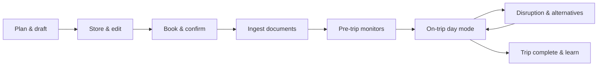

# FOGG — user journeys & product storyboard

Living product plan (Jira-free). Describes **who** FOGG serves, **what** they do end-to-end, and **what “done” feels like** at each stage. Technical choices (Svelte, `gmaps`, backend API) implement these journeys; they are not repeated here except where they clarify scope.

**Primary objective:** a personalized travel butler that helps you **plan well under time pressure**, **keep everything in one place**, and **stay ahead of disruptions**—so you can travel with confidence, not constant mental replanning.

**Interface:** every journey below is driven **in dialogue with the agent**. The shell is **chat history (left)** + **workspace frames (right)**—maps, calendars, reminders, file deposit, agent task progress, etc. See **[dialogue-interface.md](dialogue-interface.md)** for panels, frames, and backend/frontend implications.

**Related:** [`../README.md`](../README.md) (vision), [`../AGENTS.md`](../AGENTS.md) (repo layout).

---

## Persona (default)

**Alex** — busy professional, finite budget, limited planning time before departure. Enjoys travel but hates firefighting. Will accept “good enough” under stress unless shown **better options within budget**. Trust grows when suggestions match past choices and when backup plans exist before things break.

---

## Core objects (shared language)

Full macro model: **[domain/domain-model.md](domain/domain-model.md)**. Short index:

| Object | Meaning |
|--------|---------|
| **User** | Person who owns **places**, **events**, and **trips**; **bio details**, **preferences**, **conversation**, **secrets**. |
| **Bio details** | Profile facts: **gender**, **home address**, … |
| **Immigration status** | Per country: **citizenship**, **PR**, or **visa** (list, not one field). |
| **Secrets** | User-supplied credentials; **stored on device** first (encrypted), server vault only if product evolves. |
| **Preferences** | Agent-inferred taste; **supersession** forward-only; embed + geo; **activities** compared at recommend time. |
| **Message** | One turn in a **thread**; **entity links** to trip, place, activity, … |
| **Trip** | Base vacation plan: **duration** + **itinerary** (+ status, budget); owned by a **user**. |
| **Itinerary** | **Home-linked** plan of **activities** + **routes** (only when the loop home → trip → home exists). |
| **Activity** | Planned stop: **place** + **starts_at** (both required in DB); status wishlisted / reserved / in_progress / completed. Intent before that → **messages** (+ links). |
| **Place** | Persistent known location (with or without a trip); **Google** types. |
| **Place details** | Optional fields on a place (Google Place GET). |
| **Event** | Known happening (**place** + **duration**); not trip-owned; research; status suspected / known / in_progress / completed. |
| **Route** | Travel place → place; same status set as activities; **daytrip** when legs/places TBD. |
| **Transport** | Mode (and operator hint) on a route. |
| **Reservation** | On the trip; times, operator, contact, payment; links to **activities** and/or **routes**. |
| **Document** | External confirmation artifact linked to a reservation. |
| **Reminder** | One-shot **`reminders`** row; fires at **alert_at** in **conversation**. |
| **Monitor** | Recurring **`reminders`** row (`kind = monitor`); e.g. flight status, event poll. |
| **Preference signal** | Explicit or implicit event that **updates preferences** (with **message** evidence). |

---

## Itinerary snapshots

Macro rules live in **[domain/domain-model.md](domain/domain-model.md)** (trip pool, materialized paths). Summary:

| Layer | Behavior |
|-------|----------|
| **Trip pool** | **Activities** + **routes** on the trip (editable). |
| **Snapshot** | Cached home→…→home path (`itinerary_version_steps`); internal index—not “Plan v2” in UI. |
| **Head** | User’s **selected** valid snapshot on the trip. |
| **Broken** | Route/activity/place invalid → snapshot unusable; pick another or fix pool. |

Compare plans via **`diagram`** / `itinerary_diff`. Disruption (J7) materializes a new snapshot and updates **head**. **Reservations** go **stale** when linked steps leave the selected path.

---

## Lifecycle overview

---

## Scenario catalogue: planning and execution

This catalogue turns the storyboard into small, linked scenarios for future development and evaluation. **These are target behaviours, not claims that the product already supports them.** The existing Nagano Maps simulations cover a narrow subset of place searches and routes; trips, itinerary management, bookings, reminders, and disruption monitoring still need their own capabilities and fixtures.

A scenario can start from a prepared snapshot instead of replaying an entire conversation. Each scenario has an ID, starting state, trigger, controlled inputs, and observable outcomes. An evaluation should check the decisions and state changes described here without requiring the assistant to use exact wording or a fixed sequence of tool calls. Check negative outcomes as well as success. Simulated suppliers, places, prices, schedules and disruptions below are fictional; they do not establish real availability or prices.

### Shared reference trip and snapshots

The following reference data makes scenarios linkable. A test may vary individual inputs or use another destination while preserving the same decision being tested. All times in Japan use `Asia/Tokyo`; times at home use `Asia/Singapore`. Use an injected clock, not the actual date, for time-sensitive scenarios.

| ID | Starting state | Use |
|---|---|---|
| **S0 — no trip** | Alex is in Singapore and has no trip for this request. No dates, budget, party size, or transport have been confirmed. | Start a new planning conversation. |
| **S1 — intent captured** | Alex wants a winter trip to Nagano Prefecture with skiing and local food; details remain tentative. | Explore options without inventing commitments. |
| **S2 — constraints known** | Two adults; 12–17 February 2027, inclusive; total target budget SGD 4,000 for both, excluding shopping; relaxed pace; two ski days; user prefers public transport but will consider a car. These are scenario inputs, not inferred facts. | Compare options using common constraints. |
| **S3 — options compared** | Two fictional options: **A**, Hakuba base with two ski days; **B**, Nagano City base with one ski day and more sightseeing. Both are proposals; prices and travel times are simulated estimates with source and observation time. | Select or modify an option. |
| **S4 — draft plan** | Alex selected A. A candidate home-to-home path is assembled using fictional transport, lodging and activities, with times and costs shown as estimates. No item is booked. | Refine and check feasibility before booking. |
| **S5 — partially booked** | Outbound flight and first two hotel nights are confirmed; return flight and remaining hotel nights are unbooked. Confirmation documents and cancellation rules exist only where the fixture supplies them. | Prepare to book, manage missing confirmations and avoid duplicate bookings. |
| **S6 — confirmed trip** | The transport and lodging needed by the selected plan are confirmed. A fictional flight from Singapore to Japan departs **12 February 2027 at 08:00 SGT**; the fixture states check-in opens **11 February at 08:00 SGT**. A confirmed transfer to Hakuba is scheduled after arrival. | Reminders, travel-day support and disruptions. |
| **S7 — in progress** | The traveller has arrived in Japan. The selected plan includes a confirmed fictional train on **14 February at 09:00 JST**, a connecting bus at **10:00 JST**, and an activity at **12:00 JST**. | Local-time execution and transport disruptions. |

**State rules for scenarios:** conversation is the source of captured intent; a proposed place or itinerary is not a reservation. In the current domain model an activity is persisted only once its place and start time are known; an itinerary snapshot requires a complete home-to-home path. Preserve confirmed reservations and the selected plan until the user authorizes an applicable change. For a booking, cancellation, payment, or rebooking, request authorization for the specific action and do not represent it as complete without confirmation from the responsible system or user.

### Phase 1 — Planning

Planning begins with a travel desire and moves through clarification, alternatives, a draft, refinement, and preparation for booking. It is normal to go back to an earlier stage when a constraint changes.

#### P01 — Capture a broad travel idea

- **Start:** S0.
- **User:** “I want to visit Nagano. Maybe go skiing.”
- **Controlled inputs:** No prior trip context; no supplier or Maps lookup is necessary for this first turn.
- **Expected:** Recognize the destination and skiing as tentative intent. Ask a small, relevant question to progress planning, such as dates or trip length; avoid demanding every detail at once. Do not invent dates, budget, a booked trip, or a timed activity. A map focus or place lookup may be useful but must not be required for a satisfactory clarification.
- **Variants:** Destination only; activity only (“I want a ski trip”); multiple potential destinations; ambiguous “Nagano” (city versus prefecture). Ask for disambiguation when it affects the decision.
- **Links:** On clarification, continue to P02 or P03.

#### P02 — Gather and update constraints across turns

- **Start:** S1; feed the S2 constraints over two or three messages rather than in one form.
- **User:** “Two of us, 12 to 17 February, about SGD 4,000 in total.” Later: “Keep it relaxed and we prefer trains.”
- **Controlled inputs:** No lookup required; earlier turns are available as conversation context.
- **Expected:** Carry forward the party size, trip window and shared budget; distinguish an explicit preference from a hard constraint. Ask only for a missing detail that matters to the next decision. Reflect a later correction, e.g. “actually we can leave a day earlier,” rather than keeping both dates as facts.
- **Variants:** Budget is per person versus total; dates are flexible; one traveller has a hard accessibility requirement; user declines to provide a budget. Keep unknowns visible rather than assume.
- **Links:** S2 → P03–P06.

#### P03 — Find and inspect candidates

- **Start:** S2.
- **User:** “What ski resorts could we consider?”
- **Controlled inputs:** Simulated place search returns three distinct fictional resorts with IDs, names, coordinates and addresses. A variant returns zero results; another returns a tool error. No live Google calls.
- **Expected:** Present relevant candidates and identify what the returned data supports. If shown on a map, use the coordinates; do not claim a result is within a hard radius unless the search or a distance check establishes it. A search result alone is not a scheduled activity or a booking. If no results or a lookup fails, say so and offer another way forward without inventing search results.
- **Variants:** Search by area, by exact name, and within 20 km of a known centre; a missing coordinate; an unsupported place category; no ratings in the returned fields. Avoid presenting invented ratings, reviews, prices or availability as sourced facts.
- **Links:** Candidate set → P04 and P05.

#### P04 — Compare meaningful trip options

- **Start:** S2 plus P03 candidates.
- **User:** “Give us a couple of ways to do this trip.”
- **Controlled inputs:** Fictional A and B as in S3; supply estimated lodging, transport and activity costs with timestamps and explicit gaps. Include a route estimate per option.
- **Expected:** Offer a small set of genuinely different options, explain trade-offs against budget, pace, skiing and transport preference, and label unknown or unverified costs. Separate shared costs from per-person costs and do not claim an incomplete total is a full budget. Neither option is selected without user choice.
- **Variants:** Only one viable option; both exceed budget; a cheap option has a long transfer; data is stale or unavailable. Explain infeasibility and ask which constraint may change.
- **Links:** Choose A or B → P05; change requirements → P02.

#### P05 — Estimate travel between candidates

- **Start:** S3.
- **User:** “How much time would we spend getting from the airport to each base?”
- **Controlled inputs:** Simulated route responses for each pair, with distance, duration and geometry. Initial planning uses ordinary route estimates; detailed toll calculation is a separate later decision.
- **Expected:** Compare like-for-like travel modes and identify estimates and missing connections. Draw available route geometry when the user asks to see it. Do not treat a straight-line simulated polyline as a real road route or claim live conditions. A route matrix may compare several pairs; a detailed route can be fetched for a selected pair.
- **Variants:** One route unavailable; walking chosen for an impractically long transfer; no public-transport result; selected mode conflicts with preference. Explain the gap and preserve the other results.
- **Links:** User selects a base → P06.

#### P06 — Select an option and build a possible itinerary

- **Start:** S3.
- **User:** “Let’s go with the Hakuba option. Draft the days for us.”
- **Controlled inputs:** Fictional flight windows, transfers, lodging candidates, resort opening periods and activity durations are supplied. Availability is not confirmed.
- **Expected:** Assemble a coherent candidate plan with travel and rest time, identify placeholders and assumptions, and show the relationship between days and map locations. Mark costs, opening hours and availability as estimates where applicable. Present it for review before booking.
- **Variants:** Missing inbound or return leg; activity hours unknown; trip crosses midnight; only dates, not times, are known. Keep unresolved intent in conversation until the domain requirements for an activity or complete itinerary are met.
- **Links:** S4 → P07–P10.

#### P07 — Refine one part without losing the rest

- **Start:** S4.
- **User:** “Make the second ski day shorter and add an onsen nearby.”
- **Controlled inputs:** A fictional onsen candidate with location and opening hours; route estimates from the resort and back to lodging.
- **Expected:** Propose the affected change, check travel and opening times, and show the impact on that day and total estimate. Preserve unaffected days and reservations. Make clear whether the change is a proposal or has been accepted.
- **Variants:** User rejects the candidate; venue is closed; travel makes the day infeasible; a location is known but no start time exists. Do not silently convert an unresolved idea into a timed activity.
- **Links:** Accept → revised S4; unresolved conflict → P08.

#### P08 — Detect a conflict or changed constraint

- **Start:** S4.
- **User:** “Move dinner to 18:00” when the fixture says the preceding transfer arrives at 18:20; or “Our budget is now SGD 3,000.”
- **Controlled inputs:** Fixed schedule and route-duration fixtures; costs show the budget impact.
- **Expected:** Identify the affected items and the concrete conflict or shortfall, then offer feasible alternatives such as a later dinner or different transport. Do not silently discard the user’s request, mark the original plan feasible, or overwrite confirmed reservations. Ask which compromise the user accepts.
- **Variants:** Travel estimates are missing; change fits only if a reservation is cancelled; timezone or day boundary creates the conflict. Surface uncertainty and any decision deadline.
- **Links:** User chooses → revised S4; booking consequences → P09.

#### P09 — Prepare a booking checklist

- **Start:** S4 after Alex says the draft is acceptable.
- **User:** “What should I book first?”
- **Controlled inputs:** Fictional booking links and availability windows for flight, lodging, transfers and ski activities; some are unknown.
- **Expected:** Group bookable and unresolved items, explain dependencies and deadlines supported by the fixture, and distinguish estimates from confirmed availability. Provide links or next steps where known. Do not make a booking, charge money, or imply an item is confirmed merely because a link exists.
- **Variants:** A venue cannot be booked through an available integration; price changed; one item is already booked; a booking depends on another. Offer a manual next step and avoid duplicates.
- **Links:** User books externally and supplies confirmation → P10.

#### P10 — Record a booking or resolve ambiguous confirmation

- **Start:** S5.
- **User:** “I booked the hotel; here’s the confirmation,” with a fictional document or manually supplied details.
- **Controlled inputs:** One fixture matches an existing planned stay; another has ambiguous dates or no cancellation terms. No real inbox or payment provider.
- **Expected:** Link supported facts to the correct planned item, record the reservation as confirmed only when evidence supports it, and leave the remaining items unbooked. Ask about ambiguous dates, missing travellers or uncertain matches. Surface a cancellation deadline only when it is supplied; do not invent one.
- **Variants:** Duplicate confirmation; document conflicts with the draft; user corrects an extraction; partial booking; no evidence attached. Do not duplicate or silently overwrite a confirmed reservation.
- **Links:** Once needed bookings are confirmed → S6 and execution E01.

#### P11 — Restore and resume a plan

- **Start:** S4 or S5 persisted, with a prior conversation and a selected itinerary where one exists.
- **User:** Returns later: “Where were we?”
- **Controlled inputs:** Restore the chosen snapshot, unresolved questions, and reservations from their respective stores; include a stale-data variant.
- **Expected:** Summarize what is selected, what is only proposed, what is booked, and the next unresolved decision. Keep chat history distinct from itinerary and booking state. Flag facts that may need refreshing instead of asserting current availability.
- **Variants:** User has multiple trips; no complete itinerary; plan changed on another device; data missing or sync conflict. Ask which trip or surface the conflict instead of guessing.
- **Links:** Resume P07–P10 or enter execution.

### Phase 2 — Execution

Execution covers the period from pre-departure preparations through the trip. Reminders and monitors require their own future scheduling and data-source implementations; scenarios below use a controlled clock and injected events.

#### E01 — Day-before check-in reminder

- **Start:** S6; clock is **11 February 2027, 08:00 SGT**, exactly when the fixture says check-in opens.
- **Trigger:** A scheduled check-in reminder becomes due.
- **Controlled inputs:** Flight reservation and provider-supplied check-in opening time; a safe link to the airline’s check-in page if supplied.
- **Expected:** Surface a timely, actionable message identifying the flight and check-in opening time, with the supported next step. Use Singapore time for the departure and avoid claiming check-in is completed. Keep the reminder separate from flight-status monitoring.
- **Variants:** Reminder fires before opening, after opening, or after departure; no check-in time or link is available; the flight was cancelled; user already completed check-in. Do not fire early or repeatedly after completion; state uncertainty when the opening time is unknown.
- **Links:** E02 for acknowledgement or snooze; E04 for changed flight details.

#### E02 — Acknowledge, snooze and reschedule reminders

- **Start:** E01 has produced a reminder.
- **User:** “Remind me again in two hours,” then “I’ve checked in.”
- **Controlled inputs:** Clock advances deterministically; delivery acknowledgements and user actions are recorded.
- **Expected:** Schedule one reminder at the requested time, show the time and timezone, and cancel or resolve the pending repeat when the user says the task is done. Do not mark a booking or flight status changed merely because the reminder is acknowledged.
- **Variants:** Snooze beyond the useful deadline; duplicate scheduler delivery; device offline; changed flight time. Warn when the requested snooze misses a known deadline, deduplicate delivery, and recalculate only when supported by updated evidence.
- **Links:** E03 or E04.

#### E03 — Pre-trip readiness and document gaps

- **Start:** S5 or S6, two days before departure.
- **User:** “Are we ready to go?”
- **Controlled inputs:** Booking states, known departure and check-in times, and available confirmation documents; deliberately omit one document or booking in a variant.
- **Expected:** Summarize confirmed reservations, outstanding actions and known deadlines. Distinguish a missing document from an unconfirmed reservation. Provide the next action for each gap, and never assert visa, entry or supplier requirements without a reliable source and applicable traveller details.
- **Variants:** Conflicting confirmation; outdated supplier policy; user declines to upload a document. Report what is unknown and let the user correct it.
- **Links:** Resolve gaps → E01/E04.

#### E04 — Flight change before departure

- **Start:** S6; clock is 11 February 2027, 10:00 SGT.
- **Inject:** A fictional flight-status provider reports a departure delay of three hours, observed at 09:55 SGT. The next airport transfer is missed according to the fixture.
- **Controlled inputs:** Original and revised flight times, affected confirmed transfer, alternatives with availability and costs, source and observation time. A separate fixture is stale or contradictory.
- **Expected:** Explain the change and source, identify the transfer and downstream timing affected, and offer viable options with their cost/time differences and booking implications. Preserve confirmed reservations until Alex chooses and authorizes any external action; show unknowns. Reschedule relevant reminders when the revised time is authoritative.
- **Variants:** Delay resolves; provider data is stale; no alternative is available; new arrival crosses into a different local day. Avoid treating an unconfirmed alternative as booked.
- **Links:** User selects a proposed adjustment → E07; cancellation → E05.

#### E05 — Transport mode fails during the trip

- **Start:** S7; clock is **14 February 2027, 08:00 JST**.
- **Inject:** The fictional operator reports that the 09:00 train is cancelled. The bus and 12:00 activity depend on it.
- **Controlled inputs:** Cancellation source and update time; three deterministic alternatives: a later train misses the bus, a taxi arrives at 11:15 JST at a higher estimated cost, and a bus arrives at 12:30 JST. Fixture defines whether each is merely available or confirmed.
- **Expected:** Clearly identify the cancelled leg and downstream impact, compare feasible alternatives against time, cost and Alex’s transport preference, and identify the 12:00 activity as at risk. Separate an option from a reservation; ask Alex to choose before any paid or irreversible action. Preserve the previous plan and booking evidence until a change is accepted.
- **Variants:** No alternative; provider recovery is uncertain; user is already aboard; status is only a rumour; notification arrives after departure. State what is known, avoid false certainty and present a practical next action.
- **Links:** Alex selects the taxi → E07; no response → E06.

#### E06 — Time-critical decision without user response

- **Start:** E05, with a simulated taxi quote that expires at 08:20 JST.
- **Trigger:** Clock reaches 08:15 JST; Alex has not responded.
- **Controlled inputs:** Known quote expiry, notification delivery state, and no authorization to book.
- **Expected:** Send a concise reminder before the decision deadline when delivery is available; explain the consequence of inaction only if the fixture establishes it. Do not reserve or pay automatically. Record undelivered or dismissed status so the system can avoid repeated duplicate notices.
- **Variants:** App offline; quote expiry changes; user explicitly opted out; deadline already passed. Escalation policy and delivery channels remain product decisions, not assumed facts.
- **Links:** Response → E07; no viable offer → ask for another approach.

#### E07 — Accept a disruption alternative and reconcile bookings

- **Start:** E04 or E05 with a presented alternative.
- **User:** “Use the taxi option.”
- **Controlled inputs:** The alternative’s time and estimated cost, current itinerary, and any existing bookings and cancellation conditions.
- **Expected:** Record the user’s selection and update the proposed affected path; identify which existing reservations may need cancellation or confirmation. If external booking is unsupported, provide the manual next step and keep it unconfirmed. Only record a new confirmed reservation after supplier or user evidence. Recalculate dependent timing and preserve unrelated parts of the trip.
- **Variants:** User approves a plan change but not a purchase; booking fails; a confirmed supplier price differs from the quote; change invalidates a later activity. Surface each distinction and request a new decision where needed.
- **Links:** Confirmed update → revised S7; subsequent changes → E04/E05.

#### E08 — Today’s plan in local time

- **Start:** S7; clock is **14 February 2027, 07:30 JST**.
- **User:** “What’s today?”
- **Controlled inputs:** The selected itinerary, reservations and current local timezone. A variant has a flight crossing midnight and a different home timezone.
- **Expected:** Show today’s relevant items in Japan time, in order, with the next action and known booking status. Distinguish planned times from real-time status and do not claim a monitor has checked something unless it has.
- **Variants:** No scheduled activities; user asks from a different timezone; offline with cached data; an item has been skipped. Say when the information was last updated and avoid displaying yesterday’s local-day itinerary as today.
- **Links:** A reported issue → E04/E05; activity completion → E09.

#### E09 — User reports a change or completion

- **Start:** S7, with an upcoming activity and transfer.
- **User:** “We skipped the museum and are heading straight to the hotel.”
- **Controlled inputs:** Existing plan, current location only if the user has supplied or permitted it, and any relevant reservation terms.
- **Expected:** Record the user-reported change, identify any affected route or reservation, and offer an updated plan. Do not assume cancellation of a booking or infer precise location without evidence. Ask before changing or cancelling a confirmed reservation.
- **Variants:** User merely asks “what if we skip it?”; later corrects the statement; location is unavailable. Keep hypothetical and completed actions distinct.
- **Links:** Replan → E07; trip ends → E10.

#### E10 — Close the trip and preserve history

- **Start:** Final planned return leg has passed; completion evidence is supplied by Alex or a reliable fixture.
- **User:** “We’re home.”
- **Controlled inputs:** Selected plan, completed/skipped items, reservations and unresolved follow-ups.
- **Expected:** Record the trip as complete when supported, stop or resolve obsolete reminders and monitors, and preserve the conversation and reservation history. Offer optional feedback without inventing preferences from a single action.
- **Variants:** User returns early; a refund remains outstanding; a reminder is still relevant after arrival; no completion evidence exists. Preserve actionable follow-ups and do not infer completion solely from the clock.

#### E11 — Weather warning before an outdoor activity

- **Start:** A selected ski activity is scheduled for **15 February at 09:00 JST**. Clock is 13 February, 09:00 JST. The fictional reservation has a free-cancellation deadline of 14 February, 12:00 JST.
- **Inject:** A simulated forecast reports a severe snowstorm overlapping the activity; a later forecast reports the warning has been lifted.
- **Controlled inputs:** Forecast provider, observation time, affected area and severity; activity location; cancellation terms; alternative indoor activities with known opening hours. Include a variant where the forecast is stale or its coverage does not include the activity.
- **Expected:** Explain the forecast, its source and uncertainty, and the affected activity. Surface the known cancellation deadline early enough for a decision and offer options such as waiting for an update or selecting a suitable indoor alternative. Keep the reservation intact until authorized cancellation is confirmed. If the warning is lifted, update or resolve the warning rather than continuing to present it as current.
- **Variants:** Deadline has passed; forecast arrives outside the 48-hour window; one venue is already closed; no forecast is available; user dismisses the warning. Avoid asserting closures or cancellation rights that the fixture does not establish.
- **Links:** User selects an alternative → E07; no response near a known deadline → E06.

#### E12 — Duplicate or conflicting disruption reports

- **Start:** E05 has already alerted Alex to the train cancellation.
- **Inject:** The monitor receives the same cancellation twice, then an operator update says a replacement service is scheduled.
- **Controlled inputs:** Stable event identifiers, observation times, the operator’s source, and whether the replacement is confirmed or only proposed.
- **Expected:** Avoid sending duplicate alerts for the same unchanged event. Associate the newer update with the existing disruption, explain what changed, and re-evaluate affected connections. Preserve the user’s selected alternative and existing reservations until Alex decides whether to change them.
- **Variants:** Out-of-order reports; incompatible sources; an older update arrives last; replacement is later cancelled. Retain provenance and surface unresolved contradictions instead of silently treating stale information as current.
- **Links:** Reassess options → E05; user chooses an update → E07.

### Scenario execution and acceptance conventions

- **Arrange:** Seed a named snapshot or an explicit minimal state. Record the scenario ID, clock and timezone, and whether each item is proposed, selected or confirmed.
- **Act:** Supply one user message or one scheduled/injected event. Linked stages may reuse the resulting state, but each stage must also be runnable from its own fixture.
- **Simulate:** Match external calls by tool name and arguments, using exact values, ranges, geographic bounds or regex as appropriate. Provide success, empty, delayed, stale and failure responses where the scenario needs them. Unknown calls should fail visibly; never fall through to a paid API during a simulation.
- **Observe:** Inspect the assistant’s response, tool calls and results, state changes, scheduled events and UI effects relevant to that case. A trace can help diagnose a failure; it is not itself the acceptance criterion.
- **Assert:** Check required facts, action boundaries, unaffected state, timezones and uncertainty. Permit equivalent wording and different valid tool sequences. For time-based tests, advance the injected clock; avoid real sleeps.
- **Keep outcomes distinct:** A suggested option is not a selection; a selected plan is not a confirmed reservation; a reminder is not evidence that a task was completed. Track these separately in fixtures and assertions.
- **Maintain:** When converting a case to an executable simulation, record its test location and implementation status here. Update fixtures when the product contract changes; keep examples fictional and do not store credentials or sensitive customer documents.

---

## Journey 1 — “I need a trip, fast” (plan & draft)

**Trigger:** Alex has rough intent (“5 days in Kyoto, cherry season, mid budget”) and **no time** for deep research.

| Step | Alex does | FOGG does | Success |
|------|-----------|-----------|---------|
| 1 | Opens app, starts **New trip** | Asks minimal questions: dates (fixed/flexible), origin, budget band, pace (packed vs relaxed), must-haves | Trip shell created in **draft** |
| 2 | Describes trip in natural language or picks templates | Builds candidate **itinerary skeleton**: areas to stay, day themes, transfer options | Map + day list visible (OSM now; routes/places from backend later) |
| 3 | Skims options | Ranks options with **why** (price, travel time, reviews proxy, prior preferences) | Alex sees 2–3 viable shapes, not 50 tabs |
| 4 | Taps “prefer walkable” / “avoid early flights” | Updates preference model for this trip + global | Next suggestions respect signals |
| 5 | Saves plan | Trip pool + first **snapshot** + **head** | Can leave and return days later |

**Emotional beat:** Relief—“I have a coherent plan without an weekend of spreadsheets.”

**Out of scope for v1 (north star):** fully autonomous booking without confirmation; human-grade empathy copy is iterative, not day-one perfect.

---

## Journey 2 — “Let me refine this” (store, retrieve, edit)

**Trigger:** Alex returns with new constraints (friend joining, budget cut, extra day).

| Step | Alex does | FOGG does | Success |
|------|-----------|-----------|---------|
| 1 | Opens **My trips** | Lists trips by status and dates | Finds draft instantly |
| 2 | Opens trip | Loads latest itinerary + map context | Same state as left off |
| 3 | Edits one day (swap activity, move hotel) | Revalidates times/distances, flags conflicts | No impossible transfers silently |
| 4 | Compares versions (optional) | Shows diff or “before/after” summary | Trust in what changed |
| 5 | Saves | New **snapshot**; trip moves toward **planned** | Older snapshots kept (valid/superseded) |

**Emotional beat:** Control—“It’s my trip, but I’m not redoing all the math.”

---

## Journey 3 — “Book it” (reservations & confirmations)

**Trigger:** Itinerary is good enough to commit money.

| Step | Alex does | FOGG does | Success |
|------|-----------|-----------|---------|
| 1 | Marks segments **ready to book** | Produces checklist per segment (links out or assisted flow) | Clear what’s still open |
| 2 | Books on airline/hotel site (or via deep link) | Does **not** silently charge; records **booking intent** | Aligns with “smart suggestion machine,” not rogue agent |
| 3 | Enters confirmation / forwards email | Creates **Booking** records linked to segments | Trip status → **booked** (partial or full) |
| 4 | Reviews cancellation policy summary | Surfaces deadlines in timeline | Surprises reduced |

**Note:** FOGG **does not** process payments or in-app checkout (see [Non-goals](#non-goals-explicit)). Alex books on supplier sites; FOGG **tracks** confirmations and documents.

---

## Journey 4 — “Don’t lose my tickets” (documents from email)

**Trigger:** Confirmations arrive as email with PDFs.

| Step | Alex does | FOGG does | Success |
|------|-----------|-----------|---------|
| 1 | Connects inbox **or** forwards to trip alias `trip+id@…` **or** uploads files | Ingestion pipeline parses sender, dates, PNR, attachments | Documents queued for matching |
| 2 | — | Matches to **Booking** / **Segment** (confidence score) | Alex sees “matched” vs “needs review” |
| 3 | Confirms or fixes match | Stores blob + metadata in backend; searchable | One vault per trip |
| 4 | Opens trip → **Documents** | Thumbnail/list; tap to view PDF/image | Offline-friendly on mobile later |
| 5 | Day before flight, opens boarding pass | Surfaces doc on **Today** screen | No email archaeology |

**Privacy:** explicit consent for email; minimal retention; no logging of document secrets (see repo security rules).

**Emotional beat:** Safety—“Everything I need is in the app, not scattered in Gmail.”

---

## Journey 5 — “What’s tomorrow?” (pre-trip & packing mode)

**Trigger:** Departure within ~7 days.

| Step | Alex does | FOGG does | Success |
|------|-----------|-----------|---------|
| 1 | Opens trip | **Pre-trip dashboard**: countdown, open bookings, missing docs | Gaps visible |
| 2 | Enables **monitors** (defaults on for booked transport) | Creates **monitor** rows: flight status, check-in **reminder**, weather along route | List transparent in UI |
| 3 | Reviews **48h weather** per location | Forecast + impact tags (outdoor activity risk, heat, storms) | Proactive reschedule hints |
| 4 | Accepts or dismisses suggestions | Records preference signals | Model learns risk tolerance |

---

## Journey 6 — “Today is the travel day” (on-trip, daily itinerary)

**Trigger:** Trip status **in progress**; local calendar day rolls.

| Step | Alex does | FOGG does | Success |
|------|-----------|-----------|---------|
| 1 | Opens **Today** (e.g. “what’s today?” in chat) | Agent sets `trip_timeline` to **`scope: today`** — only this calendar day, time order + map | Low noise |
| 2 | Checks next step | Travel time to next point, doc shortcut, buffer | On-time confidence |
| 3 | Marks segment done / skipped | Updates live itinerary state | Evening summary stays honest |
| 4 | Adds serendipity (message + map pin) | Link **message** to **place** / **trip** | May extract **preference** with evidence |

**Emotional beat:** Presence—“I’m not thinking two steps ahead; the butler is.”

---

## Journey 7 — “Something changed” (monitors, reminders & alternatives)

**Trigger:** A **monitor** surfaces a change, or a **reminder** fires: delay, cancellation, severe weather, major event, transport strike, unusual disruption.

| Step | Alex does | FOGG does | Success |
|------|-----------|-----------|---------|
| 1 | Reminder/monitor surfaces in chat or push | Explains **what**, **by when** Alex must decide, **what happens if nothing** | No vague panic |
| 2 | Opens detail frame | Shows evidence + affected segments + knock-on conflicts | Whole trip impact visible |
| 3 | Reviews **alternatives** (2–3, not 20) | Re-plans affected slice: new flight time, indoor swap, hotel extra night, route change | Each option: cost delta, time delta, preference fit |
| 4 | Picks alternative or keeps plan | New **snapshot** + **head**; optional booking tasks | Decision recorded |
| 5 | Ignores | Learns (lightly) from dismissals | Fewer noisy **monitors** over time |

**48h weather rule:** for outdoor or transport-sensitive segments, FOGG uses a **monitor** (or chained **reminders**) up to 48 hours and prompts **before** the decision window closes (e.g. cancel-free hotel deadline, train reservation).

**Emotional beat:** Agency—“I decided early; I wasn’t cornered at the gate.”

---

## Journey 8 — “After the trip” (close & learn)

| Step | Alex does | FOGG does | Success |
|------|-----------|-----------|---------|
| 1 | Trip ends | Status → **completed** | Archive, not delete |
| 2 | Optional feedback | Short rating on suggestions vs reality | Improves future trips |
| 3 | Reuses past trip as template | Clone itinerary structure for new place | Faster next plan |

---

## Frames ↔ journeys

Full step mapping, gap analysis, and redundancy notes: **[frame-journey-map.md](frame-journey-map.md)**.

**Headline gaps:** no dedicated **bookings board** (J3/J5), weak **document library/viewer** beyond ingest (J4/J6), no **pre-trip summary** frame (J5)—trip switching is **shell**, not a frame yet.

---

## Suggested delivery phases (cheap roadmap)

Use as checkboxes in git/markdown instead of Jira epics.

### Phase A — Plan & persist (MVP core)

- [ ] Auth + user account
- [ ] CRUD **Trip** + **Itinerary** (draft/planned)
- [ ] Map + timeline UI (Svelte); places/routes via backend `gmaps`
- [ ] Retrieve & edit trips in mobile and desktop browsers

### Phase B — Bookings & documents

- [ ] **Booking** records (manual entry + email forward or upload)
- [ ] Document storage + viewer; link to bookings
- [ ] Trip status **booked**; pre-trip checklist

### Phase C — Awareness

- [ ] **Today** view for in-progress trips
- [ ] Weather lookahead (48h) on segments
- [ ] **Reminders** + **monitors** (manual + flight/weather providers)
- [ ] Due **reminders** / active **monitors** frame with explain + snooze

### Phase D — Alternatives & learning

- [ ] Impacted-segment replanning suggestions
- [ ] Preference signals affecting ranks
- [ ] Push notifications (mobile)

### Phase E — Polish

- [ ] Optional Google basemap swap
- [ ] Inbox integration (OAuth) if forward-only is insufficient

---

## Non-goals (explicit)

- **In-app booking checkout or payment** (cards, wallets, merchant-of-record)—bookings happen externally; we organize evidence and state.
- Replacing every OTA as merchant of record.
- Guaranteed real-time accuracy without provider SLAs (always show source + timestamp).
- Fully autonomous rebooking without user confirmation.
- Scraping Google Embed or other ToS-hostile shortcuts for place data.

---

## Open questions (decide as we build)

1. **Email ingestion:** forward-only alias vs Gmail OAuth vs both?
2. **Conflict resolution:** when doc match confidence is low, always ask Alex?
3. **Offline on-trip:** which docs and day schedule must work offline?
4. **Monitor noise budget:** max surfaces per day unless severity = critical?
5. **Multi-traveler:** one trip owner vs shared editing?

---

## Document maintenance

When a journey step ships or scope changes, update the **phase checkboxes** and add a dated line to [`../README.md`](../README.md) build log. Agents: see [`../AGENTS.md`](../AGENTS.md) for code layout.
