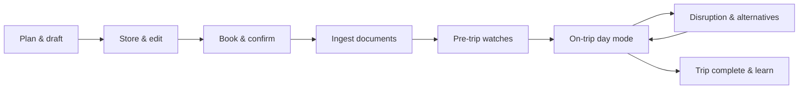

# FOGG — user journeys & product storyboard

Living product plan (Jira-free). Describes **who** FOGG serves, **what** they do end-to-end, and **what “done” feels like** at each stage. Technical choices (Flutter, `gmaps`, backend API) implement these journeys; they are not repeated here except where they clarify scope.

**Primary objective:** a personalized travel butler that helps you **plan well under time pressure**, **keep everything in one place**, and **stay ahead of disruptions**—so you can travel with confidence, not constant mental replanning.

**Interface:** every journey below is driven **in dialogue with the agent**. The shell is **chat history (left)** + **workspace frames (right)**—maps, calendars, alerts, file deposit, agent task progress, etc. See **[dialogue-interface.md](dialogue-interface.md)** for panels, frames, and backend/frontend implications.

**Related:** [`../README.md`](../README.md) (vision), [`../AGENTS.md`](../AGENTS.md) (repo layout).

---

## Persona (default)

**Alex** — busy professional, finite budget, limited planning time before departure. Enjoys travel but hates firefighting. Will accept “good enough” under stress unless shown **better options within budget**. Trust grows when suggestions match past choices and when backup plans exist before things break.

---

## Core objects (shared language)

Full macro model: **[domain-model.md](domain-model.md)**. Short index:

| Object | Meaning |
|--------|---------|
| **Trip** | Base vacation plan: **duration** + **itinerary** (+ status, travelers, budget). |
| **Itinerary** | **Time** + **destination spans** only; coarse (country + dates) → nested destinations. |
| **Destination** | Every planned place; **kind** country → … → **point** (point = location in space only). |
| **Place profile** | Optional subtype + detail on a destination (hours, reviews, pricing, …). |
| **Journey** | Travel destination → destination: departure/arrival + **transport**. |
| **Transport** | Mode, operator, **booking**, **documents** (no in-app payment). |
| **Booking / Document** | External confirmation evidence (see domain doc). |
| **Watch / Alert** | Monitors and fired disruptions + alternatives. |
| **Preference signal** | Explicit or implicit taste learning. |

---

## Itinerary versioning

Macro rules live in **[domain-model.md](domain-model.md)** (destinations, drafts, forks). Summary:

| Layer | Behavior |
|-------|----------|
| **Committed version** (`v1`, `v2`, …) | Immutable snapshot on **commit**; revisit, compare, fork from any version. |
| **Draft** | Mutable working copy; **no undo**—discard draft or commit to new version. |
| **Fork** | New draft lineage from a chosen version (often + dialogue thread fork) for options. |

Chat narrates the **draft**; **commit** makes truth. Compare versions via **`diagram`** / `itinerary_diff`. Disruption (J7) commits a new version. Bookings flag **stale** if a version removes linked journeys/spans.

---

## Lifecycle overview

---

## Journey 1 — “I need a trip, fast” (plan & draft)

**Trigger:** Alex has rough intent (“5 days in Kyoto, cherry season, mid budget”) and **no time** for deep research.

| Step | Alex does | FOGG does | Success |
|------|-----------|-----------|---------|
| 1 | Opens app, starts **New trip** | Asks minimal questions: dates (fixed/flexible), origin, budget band, pace (packed vs relaxed), must-haves | Trip shell created in **draft** |
| 2 | Describes trip in natural language or picks templates | Builds candidate **itinerary skeleton**: areas to stay, day themes, transfer options | Map + day list visible (OSM now; routes/places from backend later) |
| 3 | Skims options | Ranks options with **why** (price, travel time, reviews proxy, prior preferences) | Alex sees 2–3 viable shapes, not 50 tabs |
| 4 | Taps “prefer walkable” / “avoid early flights” | Updates preference model for this trip + global | Next suggestions respect signals |
| 5 | Saves draft | Persists trip + itinerary v1 | Can leave and return days later |

**Emotional beat:** Relief—“I have a coherent plan without an weekend of spreadsheets.”

**Out of scope for v1 (north star):** fully autonomous booking without confirmation; human-grade empathy copy is iterative, not day-one perfect.

---

## Journey 2 — “Let me refine this” (store, retrieve, edit)

**Trigger:** Alex returns with new constraints (friend joining, budget cut, extra day).

| Step | Alex does | FOGG does | Success |
|------|-----------|-----------|---------|
| 1 | Opens **My trips** | Lists trips by status and dates | Finds draft instantly |
| 2 | Opens trip | Loads latest itinerary + map context | Same state as left off |
| 3 | Edits one day (swap activity, move hotel) | Revalidates times/distances, flags conflicts | No impossible transfers silently |
| 4 | Compares versions (optional) | Shows diff or “before/after” summary | Trust in what changed |
| 5 | Saves | Writes **itinerary vN**; trip stays draft or moves to **planned** | History preserved for audit |

**Emotional beat:** Control—“It’s my trip, but I’m not redoing all the math.”

---

## Journey 3 — “Book it” (reservations & confirmations)

**Trigger:** Itinerary is good enough to commit money.

| Step | Alex does | FOGG does | Success |
|------|-----------|-----------|---------|
| 1 | Marks segments **ready to book** | Produces checklist per segment (links out or assisted flow) | Clear what’s still open |
| 2 | Books on airline/hotel site (or via deep link) | Does **not** silently charge; records **booking intent** | Aligns with “smart suggestion machine,” not rogue agent |
| 3 | Enters confirmation / forwards email | Creates **Booking** records linked to segments | Trip status → **booked** (partial or full) |
| 4 | Reviews cancellation policy summary | Surfaces deadlines in timeline | Surprises reduced |

**Note:** FOGG **does not** process payments or in-app checkout (see [Non-goals](#non-goals-explicit)). Alex books on supplier sites; FOGG **tracks** confirmations and documents.

---

## Journey 4 — “Don’t lose my tickets” (documents from email)

**Trigger:** Confirmations arrive as email with PDFs.

| Step | Alex does | FOGG does | Success |
|------|-----------|-----------|---------|
| 1 | Connects inbox **or** forwards to trip alias `trip+id@…` **or** uploads files | Ingestion pipeline parses sender, dates, PNR, attachments | Documents queued for matching |
| 2 | — | Matches to **Booking** / **Segment** (confidence score) | Alex sees “matched” vs “needs review” |
| 3 | Confirms or fixes match | Stores blob + metadata in backend; searchable | One vault per trip |
| 4 | Opens trip → **Documents** | Thumbnail/list; tap to view PDF/image | Offline-friendly on mobile later |
| 5 | Day before flight, opens boarding pass | Surfaces doc on **Today** screen | No email archaeology |

**Privacy:** explicit consent for email; minimal retention; no logging of document secrets (see repo security rules).

**Emotional beat:** Safety—“Everything I need is in the app, not scattered in Gmail.”

---

## Journey 5 — “What’s tomorrow?” (pre-trip & packing mode)

**Trigger:** Departure within ~7 days.

| Step | Alex does | FOGG does | Success |
|------|-----------|-----------|---------|
| 1 | Opens trip | **Pre-trip dashboard**: countdown, open bookings, missing docs | Gaps visible |
| 2 | Enables **watches** (defaults on for booked transport) | Registers watches: flight status, check-in window, weather along route | Watch list transparent |
| 3 | Reviews **48h weather** per location | Forecast + impact tags (outdoor activity risk, heat, storms) | Proactive reschedule hints |
| 4 | Accepts or dismisses suggestions | Records preference signals | Model learns risk tolerance |

---

## Journey 6 — “Today is the travel day” (on-trip, daily itinerary)

**Trigger:** Trip status **in progress**; local calendar day rolls.

| Step | Alex does | FOGG does | Success |
|------|-----------|-----------|---------|
| 1 | Opens **Today** (e.g. “what’s today?” in chat) | Agent sets `trip_timeline` to **`scope: today`** — only this calendar day, time order + map | Low noise |
| 2 | Checks next step | Travel time to next point, doc shortcut, buffer | On-time confidence |
| 3 | Marks segment done / skipped | Updates live itinerary state | Evening summary stays honest |
| 4 | Adds serendipity note | Optional journal pin on map | Feeds future preference, not required |

**Emotional beat:** Presence—“I’m not thinking two steps ahead; the butler is.”

---

## Journey 7 — “Something changed” (alerts & alternatives)

**Trigger:** Watch fires: delay, cancellation, severe weather, major event, transport strike, unusual disruption.

| Step | Alex does | FOGG does | Success |
|------|-----------|-----------|---------|
| 1 | Receives push/in-app **Alert** | Explains **what**, **by when** Alex must decide, **what happens if nothing** | No vague panic |
| 2 | Opens alert detail | Shows evidence + affected segments + knock-on conflicts | Whole trip impact visible |
| 3 | Reviews **alternatives** (2–3, not 20) | Re-plans affected slice: new flight time, indoor swap, hotel extra night, route change | Each option: cost delta, time delta, preference fit |
| 4 | Picks alternative or keeps plan | Writes new itinerary version; optional new booking tasks | Decision recorded |
| 5 | Ignores | Learns (lightly) from dismissals | Fewer noisy alerts over time |

**48h weather rule:** for outdoor or transport-sensitive segments, FOGG runs **lookahead watches** up to 48 hours and prompts **before** the decision window closes (e.g. cancel-free hotel deadline, train reservation).

**Emotional beat:** Agency—“I decided early; I wasn’t cornered at the gate.”

---

## Journey 8 — “After the trip” (close & learn)

| Step | Alex does | FOGG does | Success |
|------|-----------|-----------|---------|
| 1 | Trip ends | Status → **completed** | Archive, not delete |
| 2 | Optional feedback | Short rating on suggestions vs reality | Improves future trips |
| 3 | Reuses past trip as template | Clone itinerary structure for new destination | Faster next plan |

---

## Frames ↔ journeys

Full step mapping, gap analysis, and redundancy notes: **[frame-journey-map.md](frame-journey-map.md)**.

**Headline gaps:** no dedicated **bookings board** (J3/J5), weak **document library/viewer** beyond ingest (J4/J6), no **pre-trip summary** frame (J5)—trip switching is **shell**, not a frame yet.

---

## Suggested delivery phases (cheap roadmap)

Use as checkboxes in git/markdown instead of Jira epics.

### Phase A — Plan & persist (MVP core)

- [ ] Auth + user account
- [ ] CRUD **Trip** + **Itinerary** (draft/planned)
- [ ] Map + timeline UI (Flutter); places/routes via backend `gmaps`
- [ ] Retrieve & edit trips on any device (web/Android first)

### Phase B — Bookings & documents

- [ ] **Booking** records (manual entry + email forward or upload)
- [ ] Document storage + viewer; link to bookings
- [ ] Trip status **booked**; pre-trip checklist

### Phase C — Awareness

- [ ] **Today** view for in-progress trips
- [ ] Weather lookahead (48h) on segments
- [ ] Basic **watches** (manual + flight/weather providers)
- [ ] **Alerts** with explain + snooze

### Phase D — Alternatives & learning

- [ ] Impacted-segment replanning suggestions
- [ ] Preference signals affecting ranks
- [ ] Push notifications (mobile)

### Phase E — Polish & Apple

- [ ] iOS build (Mac/TestFlight)
- [ ] Optional Google basemap swap (`MapEngine.googleMaps`)
- [ ] Inbox integration (OAuth) if forward-only is insufficient

---

## Non-goals (explicit)

- **In-app booking checkout or payment** (cards, wallets, merchant-of-record)—bookings happen externally; we organize evidence and state.
- Replacing every OTA as merchant of record.
- Guaranteed real-time accuracy without provider SLAs (always show source + timestamp).
- Fully autonomous rebooking without user confirmation.
- Scraping Google Embed or other ToS-hostile shortcuts for place data.

---

## Open questions (decide as we build)

1. **Email ingestion:** forward-only alias vs Gmail OAuth vs both?
2. **Conflict resolution:** when doc match confidence is low, always ask Alex?
3. **Offline on-trip:** which docs and day schedule must work offline?
4. **Alert noise budget:** max pushes per day unless severity = critical?
5. **Multi-traveler:** one trip owner vs shared editing?

---

## Document maintenance

When a journey step ships or scope changes, update the **phase checkboxes** and add a dated line to [`../README.md`](../README.md) build log. Agents: see [`../AGENTS.md`](../AGENTS.md) for code layout.
